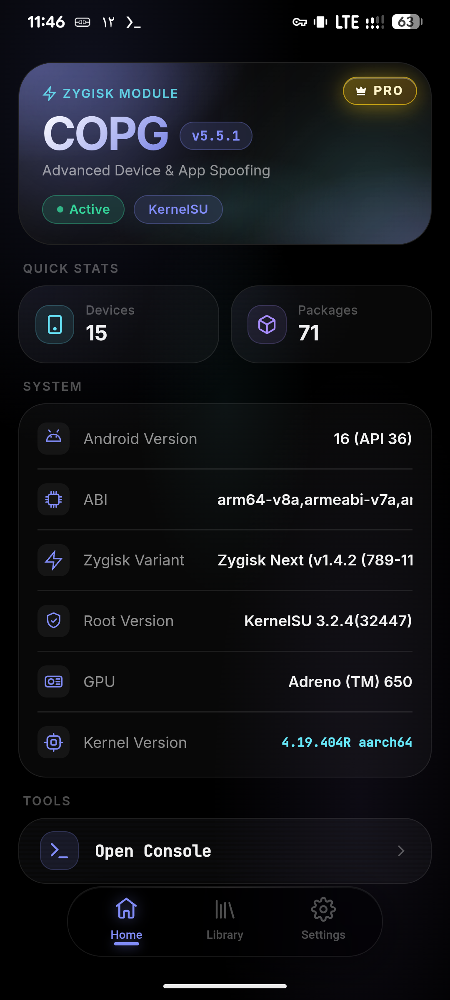
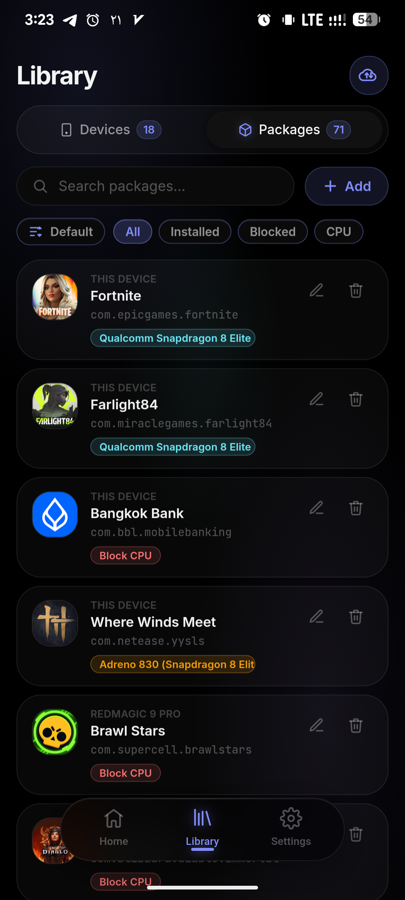
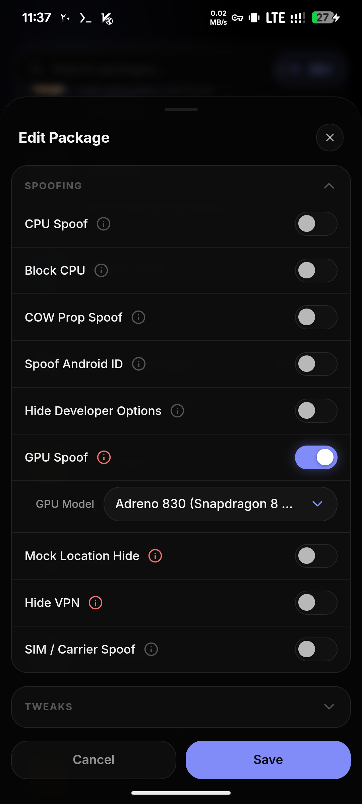
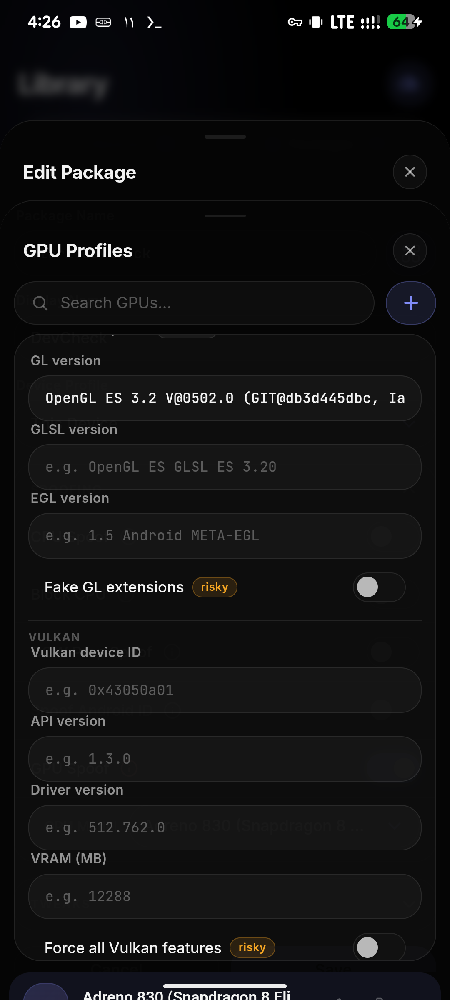

<div align="center">


# 🎮 COPG — 安卓高级定制与伪装

**一个强大的平台，支持设备与应用伪装、系统级控制以及高级 ROM 功能。**

<br>

[](https://github.com/AlirezaParsi/COPG/releases)
[](https://github.com/topjohnwu/Magisk)
[](https://www.android.com/)
[](https://github.com/AlirezaParsi/COPG/releases)
[](LICENSE)

<a href="#-安装"></a>
<a href="#-webui"></a>
<a href="#-常见问题"></a>
<a href="https://t.me/COPG_module"></a>
<a href="https://vendors.copg.my"></a>
<a href="#-支持-copg"></a>

**🌐 官方网站 —— 免费下载 COPG 并购买 COPG PRO：[vendors.copg.my](https://vendors.copg.my)**

🌐 语言 / Languages：[English](README.md) · **简体中文**

</div>

---

## ✨ 为什么选择 COPG？

COPG 是一个 **Zygisk 模块**，能让绝大多数游戏和应用误以为它们运行在另一台配置全开的旗舰设备上，
从而解锁那些原本只对特定硬件开放的高帧率模式、HD 画质和高级档位。它还搭配了一个 **CPU 伪装器**、
一个用户态的 **舒适化调节控制器**，以及一个精美的设备端 **WebUI** 来统一管理一切 —— 全部 **无需重启**。

<table>
<tr>
<td width="50%" valign="top">

#### 🎯 设备伪装
按应用配置的设备档案（品牌、型号、指纹、SDK、**基带**、**按应用序列号** 以及 12 个额外的 Build 字段），
让每款游戏都看到它想奖励的那台旗舰机。

#### 👥 按用户伪装 *(新)*
让 **同一个应用在不同 Android 用户下看到不同的设备** —— 双开 / 应用分身（HyperOS、One UI）、
工作资料、第二用户。主副本读到一台手机，分身读到另一台；每个分身甚至会得到各自派生的
Android ID / 序列号 / 广告 ID / IMEI。应用选择器的 **"Apps for"** 抽屉会自动找出你的分身。

#### ⚙️ CPU 伪装
把 CPU 伪装成旗舰级芯片，适用于那些依据芯片组来开放功能的应用。

#### 🎨 GPU 伪装 *(PRO · 需手动开启)*
按应用伪装 **GPU** —— OpenGL 渲染器/厂商 与 Vulkan 设备名 —— 适用于依据显卡开放画质的游戏。
**GPU 伪装是 PRO 功能**（需授权解锁）。它是一个 **常驻** 钩子，因此被放在明确的 *风险自负* 开关后面 ——
**切勿对反作弊游戏启用。**

#### 🖥️ 刷新率伪装 *(免费)*
让应用读到 **自定义的屏幕刷新率**（如 120 / 144 / 165 Hz）—— 当前刷新率 **以及** 完整的受支持模式列表 ——
适用于会显示或依据屏幕 Hz 来开放功能的设备信息类应用和游戏。
常驻钩子，位于 *风险自负* 开关后面 —— 切勿用于反作弊游戏。

#### 📡 IMEI 与设备 ID *(PRO)*
伪造 **IMEI / 设备 ID** —— 可 **按应用**，也可用新的 **全局 IMEI** 做到 **全设备生效**
（挂钩电话服务，让设置、`*#06#` 和每个应用都读到它；运行在应用无法扫描的独立进程中，因此 **无需风险开关**）。

#### 🔒 DRM / Widevine *(PRO)*
上报更高的 **Widevine 安全等级**（L1 / L2 / L3），并伪装 DRM 的 **设备 ID 与 系统 ID**，
适用于依此开放或显示的应用。

#### 🌍 时区与语言 *(免费)*
为每个应用设置各自的 **时区** 和各自的 **语言 / 地区**（BCP‑47）—— 应用会读取甚至 **渲染** 为伪装的区域设置。
以隐蔽、系统侧的方式生效，因此不会有任何东西加载进应用。

#### ⏱️ 伪造运行时长 *(PRO)*
让应用以为设备已经运行了 **好几天** —— 同时改写 Java 与原生的运行时长读取，
适用于对刚重置过的设备存疑的反欺诈 / 拉新流程。

#### 🌐 WebView User‑Agent *(PRO)*
给任何基于 WebView 的应用设置各自的 **浏览器 User‑Agent**（来自可复用的命名档案）——
适用于依据浏览器身份来开放内容、排版或定价的网站和应用内页面。

#### 📸 截图与存储解锁 *(免费)*
**全设备禁用 FLAG_SECURE**，即可对那些屏蔽截图的应用（银行、聊天、钱包）进行截图 / 录屏 ——
在系统层完成，应用无法察觉 · **解除存储限制** 重新允许在系统文件选择器中选取
Android/data、obb、SD 卡根目录和 Download。两者均可无需重启即时切换。

#### 🎟️ Play 来源与 PairIP 绕过 *(PRO)*
让应用看起来是 **通过 Play 安装的**（安装来源 → Google Play），并 **拦截 Google 的 PairIP 授权校验**，
使付费 / 锁定的应用能正常打开。两者都运行在系统里、应用之外 —— 没有任何东西加载进应用进程，
因此 **不可被检测**。

</td>
<td width="50%" valign="top">

#### 🧬 属性伪装与 Android ID
隐蔽的 **写时复制（copy‑on‑write）** 属性伪装（指纹、Build 属性等）*(PRO)* 以及按应用的
**Android ID** *(PRO)* —— 两者都是隐蔽的：模块会在游戏运行前卸载，内存中不留下任何 COPG 痕迹 ——
即便对反作弊游戏也安全。（CPU 伪装、设备档案、Build/序列号字段和 屏蔽 CPU 仍为免费。）

#### 📶 SIM / 运营商伪装 *(PRO)*
让应用读到不同的 **网络运营商** —— 名称、运营商代码（MCC/MNC）与国家 —— 可按应用设置，
甚至可 **为每张 SIM 卡槽设置不同运营商**。**安全** 模式完全隐蔽（反作弊安全）；
**激进** 模式还覆盖较新的订阅 API，但为常驻式（需手动开启，切勿用于反作弊游戏）。

#### 🆔 按应用广告 ID *(PRO)*
给每个应用各自的 **Google 广告 ID（GAID）** —— 可按应用自动生成，也可固定一个精确的 UUID ——
适用于广告 / 奖励 / 拉新 / 多账号类应用，让每次安装都看起来像一台不同的设备。

#### 🧩 按应用 App Set ID *(PRO)*
给每个应用各自的 **Google App Set ID** —— 这是广告 / 分析 SDK 通过 Play 服务读取的可重置指纹信号 ——
可按应用自动生成，也可固定精确 UUID，让每个应用看起来都是独立设备。
这是一个 **常驻** 钩子，位于 *风险自负* 开关后面 —— **切勿用于反作弊游戏。**

#### 🔗 Wi‑Fi / 蓝牙 MAC *(PRO)*
给每个应用各自伪造的 **Wi‑Fi 与蓝牙 MAC 地址** —— 可按应用稳定派生、每次启动刷新，或固定为精确地址。
常驻内联钩子，位于 *风险自负* 开关后面 —— **切勿用于反作弊游戏或银行类应用。**

#### 🔑 Boot ID *(PRO)*
给每个应用各自伪造的 `/proc` **boot_id** —— 本应每次开机唯一的值不再把你的多个账号关联到同一台设备。
常驻钩子，位于 *风险自负* 开关后面 —— **切勿用于反作弊游戏。**

#### 🎲 每次启动随机化 ID *(PRO)*
每次冷启动时重新生成所有派生 ID（Android ID、序列号、广告 ID、App Set ID、IMEI、boot ID、MAC）——
搭配随机设备档案即可在每次启动获得全新身份。

#### 🌐 按应用代理 *(PRO)*
让单个应用通过你自己的 **SOCKS5 / HTTP / SOCKS4** 代理，使其流量从该 IP 与国家出口 ——
无 VPN、无应用可见的网络接口、应用内无任何运行组件（内核级，防封安全）。
可保存多个代理并按应用分配；搭配匹配的 SIM/地区，让设备、SIM 与 IP 三者一致。

#### 📍 GPS 定位伪装 *(PRO)*
把应用放到 **地图上任意位置** —— 从内置列表选择国家/城市（135 个地点），或直接填入你自己的经纬度。
覆盖常规定位 API **以及** Google 的 Fused/GMS 提供器；仅改动经纬度（精度/海拔保持真实）。
常驻钩子，位于 *风险自负* 开关后面 —— 切勿用于反作弊游戏。

#### 🧭 传感器伪装 *(PRO · 新)*
给每个应用各自的 **传感器指纹**。反欺诈 SDK 会把设备的传感器列表（加速度计、陀螺仪、磁力计……）
哈希成一个稳定 ID —— 如果 Build 说是一台手机、而传感器却是另一台，这种不一致就是破绽。COPG 为每个
传感器的 **名称和厂商** 都改写为按应用稳定但唯一的值。常驻钩子，位于 *风险自负* 开关后面 —— 切勿用于反作弊游戏。

#### 🖼️ WebView 画布伪装 *(PRO · 新)*
破解 WebView 应用中的 **画布指纹（canvas fingerprint）**。网站会对隐藏的 `<canvas>` 取哈希来识别你；
COPG 加入微小、按应用、*稳定* 的噪声，使每个 WebView 应用读到不同但一致的画布指纹，包括 iframe 内部。
（WebGL 已由 GPU 伪装覆盖。）常驻钩子，风险自负。

#### 🧠 Tensor 功能解锁 *(PRO · 新)*
让选定的应用看到 Google Pixel 的 **Tensor** 系统功能 —— 从而让 Google 应用开放其依赖 Tensor 的
**AI / 专属功能**。运行在 **`system_server` 进程之外**，因此不会有任何东西加载进应用，不可被检测
（位于「系统服务伪装」总开关下 —— 开启后需重启）。

#### 🛡️ 隐私隐藏
**隐藏 VPN** —— 同时覆盖 Java（网络接口 / 能力）与原生接口检测，pairip 安全 *(免费)* ·
**隐藏模拟定位** *(PRO)* · **隐藏开发者选项 + USB 调试**（免费）—— 通过银行与隐私敏感应用的检测。

#### 🎛️ 按应用舒适化调节
自动 **勿扰模式**、**禁用自动亮度**、**保持屏幕常亮**、**停止日志** 以及按应用的 **屏幕 DPI** ——
仅在被标记的游戏处于活跃状态时生效，之后自动还原。

</td>
</tr>
</table>

> 🔁 **无需重启即可添加或移除设备、游戏与应用。** ✨ 完全可定制。 🌍 支持 10 种语言的 WebUI，
> 带浅色 / 深色 / AMOLED 主题。

---

## 🚀 释放你的游戏性能

<div align="center">

| 游戏 | 解锁 |
|------|--------|
| **使命召唤手游 (CODM)** | 120 FPS (BR / MP) |
| **PUBG Mobile / BGMI** | 120 FPS · 触觉反馈 |
| **三角洲行动 (Delta Force)** | 120 FPS · HD 画质 |
| **Free Fire / Free Fire MAX** | 144 FPS |
| **无尽对决 (Mobile Legends: Bang Bang)** | 144 FPS |
| **堡垒之夜 (Fortnite)** | 120 FPS |
| **狂野飙车 9 (Asphalt 9)** | 120 FPS |
| **Farlight 84** | 最高画质 |
| **暗区突围 (Arena Breakout)** | 90 / 120 FPS |
| **王者荣耀 (Honor of Kings)** | 高帧率模式 |
| _…以及 69+ 款更多_ | 解锁高级档位 |

</div>

#### 📱 应用增强
- **TikTok** —— 以完整 1080p 播放

---

## 🖼️ 截图

<div align="center">
<table>
  <tr>
    <td align="center" width="25%">
      
      <br><sub><b>仪表盘</b> · 系统信息</sub>
    </td>
    <td align="center" width="25%">
      
      <br><sub><b>库</b> · 应用包</sub>
    </td>
    <td align="center" width="25%">
      
      <br><sub><b>按应用</b> · 伪装开关</sub>
    </td>
    <td align="center" width="25%">
      
      <br><sub><b>GPU</b> · 档案编辑器</sub>
    </td>
  </tr>
</table>
</div>

---

## 📦 安装

### 环境要求

- 一台 **已 root** 的 Android 设备（**9.0+**）
- 一种 root 方案 **+ 一个 Zygisk 实现**：

| Root | 最低版本 | Zygisk |
|------|:------:|--------|
|  | 24 | [Zygisk Next](https://github.com/Dr-TSNG/ZygiskNext) · [ReZygisk](https://github.com/PerformanC/ReZygisk) · [NeoZygisk](https://github.com/JingMatrix/NeoZygisk) |
|  | 0.6.6 | [Zygisk Next](https://github.com/Dr-TSNG/ZygiskNext) · [ReZygisk](https://github.com/PerformanC/ReZygisk) · [NeoZygisk](https://github.com/JingMatrix/NeoZygisk) |
|  | 0.10 | [Zygisk Next](https://github.com/Dr-TSNG/ZygiskNext) · [ReZygisk](https://github.com/PerformanC/ReZygisk) · [NeoZygisk](https://github.com/JingMatrix/NeoZygisk) |

> [!IMPORTANT]
> **不支持** 标准 / 内置的 **Magisk Zygisk**（不安全）。请使用上面任意一个 Zygisk 实现。

### 获取模块

[](https://mmrl.dev/repository/zguectZGR/COPG)
[](https://github.com/Magisk-Modules-Alt-Repo/COPG)
[](https://github.com/KernelSU-Modules-Repo/COPG)

从 **[MMRL](https://mmrl.dev/repository/zguectZGR/COPG)** 安装（自动更新）、从
**[Magisk Alt Repo](https://github.com/Magisk-Modules-Alt-Repo/COPG)** 或
**[KernelSU 模块仓库](https://github.com/KernelSU-Modules-Repo/COPG)** 安装，
或从 **[Releases](https://github.com/AlirezaParsi/COPG/releases)** 获取最新的 `COPG.zip`。

### 步骤

1. 从 [Releases](https://github.com/AlirezaParsi/COPG/releases) 下载最新的 **`COPG.zip`**。
2. 通过你的 root 管理器安装 → **模块 → 从存储安装 → 选择 ZIP**。
3. **重启。**
4. 确认它出现在 root 管理器中（找 **✨ COPG spoof ✨**）。
5. 打开模块的 **WebUI** 来管理设备、游戏和调节项。

---

## 🖥️ WebUI

内置于模块中的、无需重启的设备端控制面板。在 **KernelSU** 和 **APatch** 上可直接从管理器打开。
在 **Magisk** 上，请安装 **KSU WebUI** 应用并从那里打开 COPG。

- 📋 **库** —— 添加与管理 **设备档案** 和 **按应用伪装列表**，支持搜索、排序与筛选
- ➕ **添加应用** —— 选择任意已安装应用，选定设备档案，切换 **CPU / GPU / SIM /
  属性 / Android ID / 广告 ID (GAID) / App Set ID / DRM / IMEI / Wi‑Fi MAC / 蓝牙 MAC /
  Boot ID / 传感器 / 画布 / Tensor / GPS / 代理 / 时区 / 语言 / WebView User‑Agent /
  伪造运行时长 / 模拟定位隐藏 / 隐藏 VPN / 隐藏开发者选项 / 随机化 ID** 以及
  **勿扰 / 自动亮度 / 屏幕常亮 / 屏幕 DPI** 调节
- 📊 **仪表盘** —— 实时系统信息：Android、ABI、Zygisk 变体、root 与内核
- ✅ **钩子状态** —— 全设备面板（设置），显示 COPG 最近实际应用的伪装值（型号、CPU、Android ID、
  传感器、运营商……）以及对应的应用和时间
- 🆔 **广告 ID** —— 查看、随机化、设置自定义值或恢复真实 ID（设置 · 免费）
- 📡 **全局钩子** —— 全设备的 **全局 IMEI**（设置）：让每个应用、`*#06#` 和拨号盘都读到同一个伪造 IMEI
- 💾 **备份 / 恢复** 与 **从 GitHub 同步**
- 🎨 **浅色 / 深色 / AMOLED** 主题 · 🌍 **10 种语言**（EN、FA、AR、DE、ES、PT‑BR、ID、TH、TR、ZH）

<details>
<summary><b>⚙️ 进阶 —— 手动编辑档案</b></summary>

<br>

推荐使用 WebUI 来管理档案，但你也可以直接编辑
`/data/adb/modules/COPG/COPG.json`：

```json
{
  "PACKAGES_REDMAGIC_9_PRO": [
    "com.mobilelegends.mi",
    "com.supercell.brawlstars:with_cpu"
  ],
  "PACKAGES_REDMAGIC_9_PRO_DEVICE": {
    "BRAND": "ZTE",
    "MODEL": "NX769J",
    "FINGERPRINT": "ZTE/NX769J/..."
  }
}
```

应用 **标签** 是冒号后缀 —— 例如 `:cpu=<model>`（CPU 伪装 + 选芯片）、
`:gpu=<model>`（GPU 伪装 + 选 GPU）、`:cow`（属性伪装）、`:aid`（Android ID）、
`:serial`（按应用序列号）、`:gaid`（广告 ID）、`:appset`（App Set ID）、`:drm`（Widevine）、
`:imei`（IMEI）、`:sim=<carrier>` / `:simx=<carrier>`（SIM · 安全 / 激进）、`:tz=<zone>`（时区）、
`:lang=<bcp47>`（语言 / 地区）、`:ua=<profile>`（WebView User‑Agent）、`:uptime=<sec>`（伪造运行时长）、
`:sensor`（传感器伪装）、`:webfp`（WebView 画布伪装）、`:tensorfeat`（Pixel Tensor 功能）、
`:gps=<lat>,<lng>`（GPS 定位）、`:proxy`（按应用代理）、
`:mac` / `:btmac`（Wi‑Fi / 蓝牙 MAC）、`:bootid`（boot ID）、`:randid`（每次启动随机化 ID）、
`:mock`（模拟定位隐藏）、`:vpn` / `:vpnn`（VPN 隐藏 · 应用内 / + 原生）、`:hidedev`（隐藏开发者选项）、
`:blocked`（强制真实 CPU）、`:dnd` / `:dab` / `:kso` / `:nolog` / `:dpi=<n>`（舒适化调节）。

</details>

---

## ❓ 常见问题

<details>
<summary><b>🤔 COPG 是什么的缩写？</b></summary>
<br>
最初是 <b>CO</b>（Call of Duty）+ <b>PG</b>（PUBG）—— 也就是它最早为之打造的两款游戏。
如今它已支持绝大多数游戏和应用，但为了纪念这段历史，名字保留了下来。
</details>

<details>
<summary><b>📌 会不会导致封号？</b></summary>
<br>
COPG 以不可检测为目标进行设计，但无法保证绝对安全。<b>使用风险自负。</b>
</details>

<details>
<summary><b>⚡ 会影响性能吗？</b></summary>
<br>
影响极小。伪装只在应用启动时运行，不会触碰游戏内性能。
</details>

<details>
<summary><b>🔧 如何打开 WebUI？</b></summary>
<br>
在 <b>KernelSU</b> 和 <b>APatch</b> 上，直接从管理器打开。在 <b>Magisk</b> 上，安装
<b>KSU WebUI</b> 应用并从那里打开 COPG。
</details>

---

## 💬 社区

<div align="center">

[](https://t.me/COPG_module)
[](https://t.me/TheAOSP)

</div>

> 🌐 **翻译由社区驱动。** 作者仅维护英文与波斯文 —— 非常欢迎为其他语言提交 PR！

---

## ₿ 支持 COPG

COPG 是我利用业余时间开发并免费提供的。如果它让你的游戏体验更上一层楼，欢迎 **随意打赏任意金额** ——
每一份支持都是持续做出更强版本的真实动力。在 GitHub 点一颗 ⭐ 也帮助很大！

| 网络 | 地址 |
| --- | --- |
|  | `0xB8eb7Ea033823C9aA4616B0648B89CDbC931BAAd` |
|  | `0xB8eb7Ea033823C9aA4616B0648B89CDbC931BAAd` |
|  | `UQAOHoREeGeJ0_kzJpSW3m-6Dlb_lzdHpT1a-gA7NkbuCM8N` |

> ⚠️ 转账前请 **再三核对网络** —— 发送到错误链上的资金可能会永久丢失。

---

## 📈 活跃度

<div align="center">


</div>

---

<div align="center">

**如果 COPG 提升了你的游戏体验，点一颗 ⭐ —— 真的很有帮助！**

由 **Alireza Parsi** 用 ❤️ 打造 · © 2026 COPG Project

</div>
